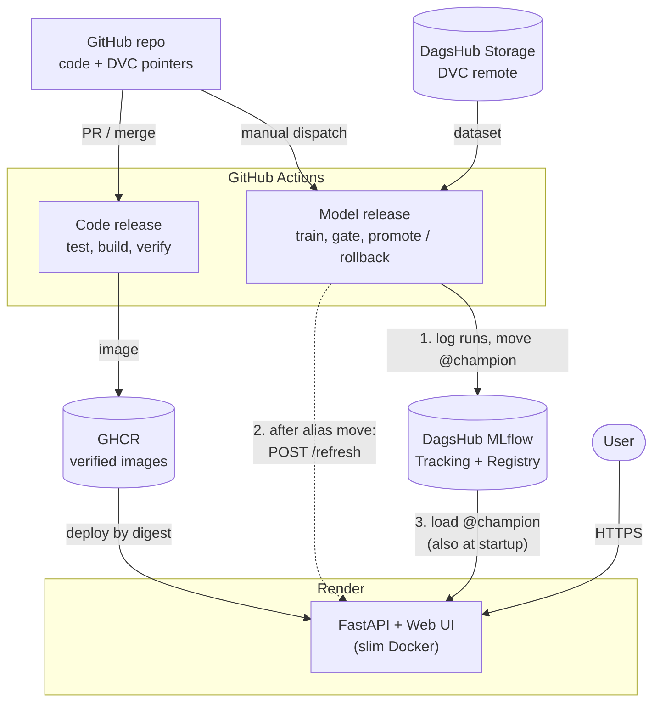
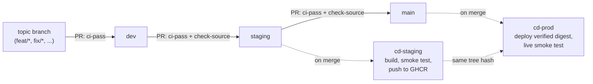

# enercast-mlops

**End-to-end MLOps reference architecture for household appliance energy forecasting.**

`enercast-mlops` predicts household appliance energy consumption (in Watt-hours, `Wh`) from the [UCI Appliances Energy Prediction](https://archive.ics.uci.edu/dataset/374/appliances+energy+prediction) dataset. It demonstrates a complete production ML lifecycle: DVC-versioned datasets, MLflow experiment tracking and model registry, a containerized FastAPI inference service with a web UI, GitHub Actions CI/CD, and gated continuous training with auditable rollback.

---

## Architecture

Code releases and model releases follow separate pipelines and meet only at runtime inside the running service: Render serves the verified container image, and the service loads the `@champion` model from MLflow on startup or via `POST /refresh`. Deploying code never alters the active model, and promoting or rolling back a model never redeploys the container.



### Tech Stack

* **Application & Inference**: Python 3.12, `uv`, FastAPI, Pydantic, Scikit-Learn
* **Data Versioning**: DVC with DagsHub Storage remote
* **Experiment Tracking & Model Registry**: MLflow on DagsHub
* **Containerization & Hosting**: Slim Docker image (`python:3.12-slim`) published to GHCR and deployed on Render
* **Automation**: GitHub Actions for PR validation, staging verification, production deployment, continuous training, and model rollback

---

## Live Service & Quick Start

* **Web UI**: <https://enercast-mlops-tree.onrender.com>
* **Interactive OpenAPI / Swagger UI**: <https://enercast-mlops-tree.onrender.com/docs>

Inspect the model currently serving in production:

```bash
curl https://enercast-mlops-tree.onrender.com/model-info
```

To run the test suite, pull datasets, or build and smoke-test the container locally, follow the setup guide in [`CONTRIBUTING.md`](CONTRIBUTING.md).

---

## Release Flow

All changes promote sequentially across three protected branches:



Every pull request must pass `ci-pass` (lockfile check, workflow linting, secrets scan, Ruff lint/format, Pytest, Docker build and container smoke test, and Conventional Commit PR title). See [`CONTRIBUTING.md`](CONTRIBUTING.md) for branch protection rules and [`docs/DEPLOYMENT.md`](docs/DEPLOYMENT.md) for full CI/CD and operations details.

---

## Documentation

Each topic has a single authoritative guide:

| Document | Scope |
| :--- | :--- |
| [`CONTRIBUTING.md`](CONTRIBUTING.md) | Local development setup, `.env` and DVC credentials, local tests and Docker smoke tests, Git workflow, branch protection, and ML hygiene rules |
| [`docs/API.md`](docs/API.md) | HTTP API and web UI contract: endpoints, request/response schemas, physical validation rules, examples, and error responses |
| [`docs/DEPLOYMENT.md`](docs/DEPLOYMENT.md) | Production runtime configuration, GitHub Actions workflows, repository variables/secrets, release procedures, and incident recovery |
| [`ml/README_data.md`](ml/README_data.md) | Dataset provenance and license, feature schema, data quality contract, chronological split design, and DVC checksums |
| [`ml/README_experiments.md`](ml/README_experiments.md) | MLflow conventions, primary metric, model configurations, continuous training gates, promotion evidence, and run logging schema |

---

## Repository Structure

```text
enercast-mlops/
├── .github/workflows/       # CI, staging/prod CD, continuous training, rollback
├── app/                     # FastAPI inference service and static web UI
├── data/                    # DVC-tracked dataset pointers (.dvc)
├── docs/                    # API reference and deployment/operations runbook
├── ml/                      # Preprocessing, splits, training, policy, registry, ML docs
├── notebooks/               # Exploratory data analysis
├── scripts/                 # Smoke-test script (local and CI/CD)
├── tests/                   # Pytest unit and integration test suite
├── Dockerfile               # Slim production container image
├── pyproject.toml           # Project metadata and dependency groups
├── uv.lock                  # Locked dependency versions
└── CONTRIBUTING.md          # Contributor and local setup guide
```
