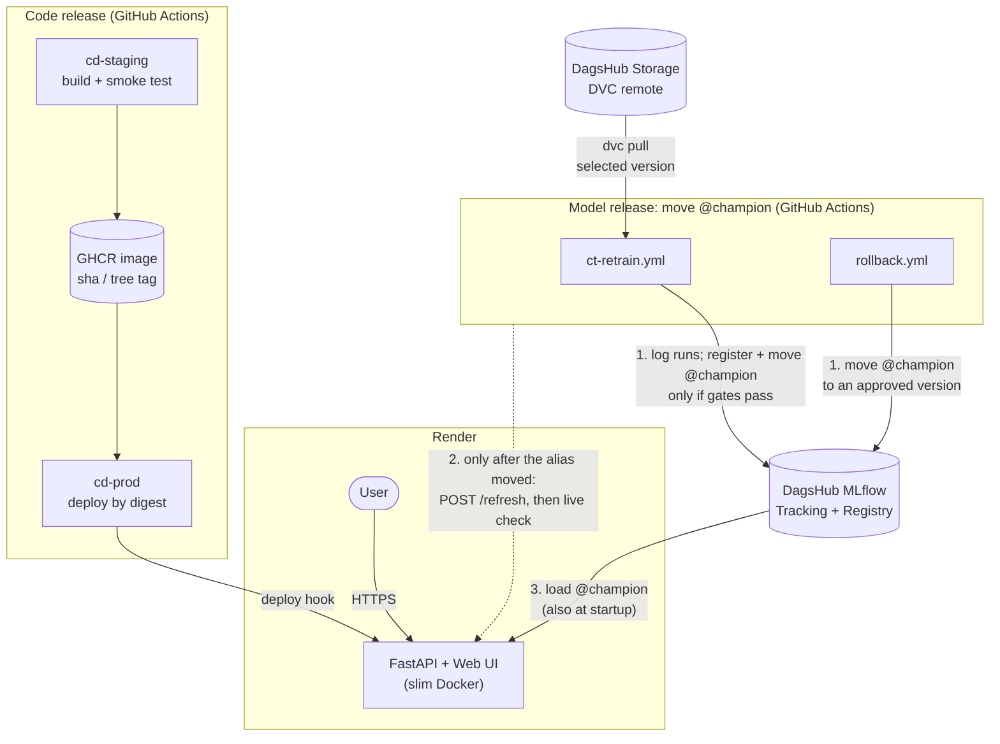
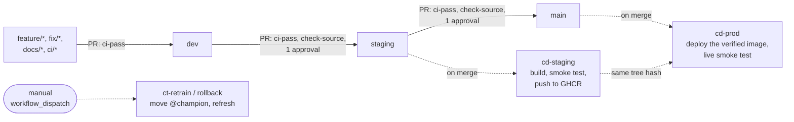

# enercast-mlops

**MLOps course project: an end-to-end ML lifecycle for household energy forecasting**

`enercast-mlops` simulates how a machine learning model is trained, released and operated in a production setting. It predicts household appliance energy use (Wh) from the [UCI Appliances Energy Prediction](https://archive.ics.uci.edu/dataset/374/appliances+energy+prediction) dataset and covers the whole path: versioned data (DVC), tracked experiments and a model registry (MLflow), a containerized inference API, CI/CD with GitHub Actions, and continuous training with gated promotion and rollback.

---

## System Architecture & Tech Stack



* **Application & Inference**: Python, FastAPI, Pydantic, Scikit-Learn
* **Data Versioning**: DVC with DagsHub Storage remote
* **Experiment Tracking & Registry**: MLflow tracking server and model registry on DagsHub
* **Containerization & Operations**: Slim Docker image, configured through environment variables
* **Automation**: GitHub Actions for PR validation, staging verification, production deployment, gated continuous training, and rollback

Code and model are released separately and meet only in the running service:
Render runs the image, and the image loads `@champion` from MLflow at runtime.
A code deploy never changes the model; a model change never redeploys the code.

---

## Branch Flow & Workflows



* **`ci-pass`** (`ci-pr.yml`, every PR into `dev`, `staging` or `main`): lockfile, actionlint, gitleaks, ruff, pytest, Docker build and container smoke test, PR title. A failing PR cannot merge.
* **`check-source`** (`enforce-source-branch.yml`): only `dev` → `staging` and `staging` → `main`.
* **`cd-staging`** (merge to `staging`): validates the release candidate against the real registry, then publishes it as `:<commit-sha>` and `:tree-<tree-hash>`.
* **`cd-prod`** (merge to `main`): deploys that exact image to Render by digest, waits until it is live, then smoke-tests the live URL with a real prediction and the expected `@champion` version.
* **`ct-retrain`** / **`rollback`** (manual): change the served model without a redeploy.

Full trigger table and reproduction steps: [`docs/DEPLOYMENT.md`](docs/DEPLOYMENT.md#workflows-and-the-branches-that-trigger-them). Branch rules: [`CONTRIBUTING.md`](CONTRIBUTING.md#2-git-branching--pull-request-workflow).

---

## Live Service

* **Production Web App & API**: `https://enercast-mlops-tree.onrender.com`
* **Interactive Swagger UI**: `https://enercast-mlops-tree.onrender.com/docs`
* **Sample requests, schemas and errors**: [`docs/API.md`](docs/API.md)

Check which model version is serving:

```bash
curl https://enercast-mlops-tree.onrender.com/model-info
```

---

## Documentation

| Doc | Scope |
| :--- | :--- |
| [`CONTRIBUTING.md`](CONTRIBUTING.md) | Local setup, branch flow and protection, commits, PRs, local checks |
| [`docs/API.md`](docs/API.md) | HTTP contract: endpoints, schemas, validation, errors, examples |
| [`docs/DEPLOYMENT.md`](docs/DEPLOYMENT.md) | Configuration, workflows and their triggers, deploying, recovery |
| [`ml/README_data.md`](ml/README_data.md) | Dataset source, license, versions, splits, DVC hashes, data contract |
| [`ml/README_experiments.md`](ml/README_experiments.md) | Metric, quality gates, MLflow runs, promotion evidence, CT and rollback logic |

---

## Repository Structure

```text
enercast-mlops/
├── .github/workflows/       # CI/CD, continuous training, rollback
├── app/                     # Inference API and web UI
├── data/                    # DVC-tracked datasets
├── docs/                    # API and deployment docs
├── ml/                      # Training, promotion policy, model registry
├── notebooks/               # Exploratory analysis
├── scripts/                 # Scripts used by GitHub Actions
├── tests/                   # Pytest suite
├── Dockerfile               # Production image
├── pyproject.toml           # Dependencies
└── CONTRIBUTING.md
```
