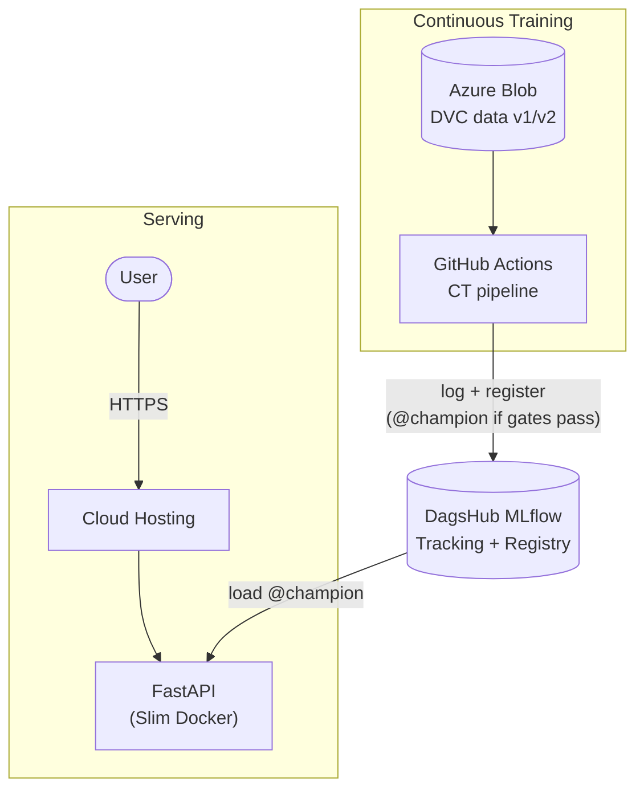

# enercast-mlops

**End-to-End Production MLOps Reference Project for Time-Series Energy Forecasting**

`enercast-mlops` is a production-ready machine learning reference implementation built around the [UCI Appliances Energy Prediction](https://archive.ics.uci.edu/dataset/374/appliances+energy+prediction) dataset. It demonstrates how to take a time-series regression model from versioned data ingestion to automated Continuous Integration, Continuous Deployment, and Continuous Training (**CI/CD/CT**) with zero-downtime model promotion and rollback.

---

## System Architecture & Tech Stack



* **Application & Inference**: Python, FastAPI, Pydantic, Scikit-Learn
* **Data Versioning**: DVC with Azure Blob Storage remote
* **Experiment Tracking & Registry**: MLflow tracking server and model registry on DagsHub
* **Containerization & Operations**: Slim Docker image adhering to the [Twelve-Factor App](docs/DEPLOYMENT.md) methodology
* **Automation**: GitHub Actions for PR validation, staging verification, production deployment, gated continuous training, and rollback

---

## Live Service & Quickstart

* **Production Web App & API**: `https://<your-deployed-service-url>`
* **Interactive Swagger UI**: `https://<your-deployed-service-url>/docs`
* **API Contract & Schemas**: See **[`docs/API.md`](docs/API.md)** for full request/response specifications, validation constraints, and status codes.

### Quick Sample Request (`POST /predict`)

```bash
curl -X POST "https://<your-deployed-service-url>/predict" \
  -H "Content-Type: application/json" \
  -d '{
    "date": "2016-05-15 19:30:00",
    "lights": 20,
    "T1": 22.5, "RH_1": 41.2, "T2": 21.8, "RH_2": 40.5,
    "T3": 23.1, "RH_3": 39.8, "T4": 21.4, "RH_4": 38.9,
    "T5": 20.2, "RH_5": 48.1, "T6": 14.3, "RH_6": 62.0,
    "T7": 20.8, "RH_7": 37.5, "T8": 22.0, "RH_8": 42.1,
    "T9": 20.5, "RH_9": 41.0, "To": 13.8, "Pressure": 756.4,
    "RH_out": 65.0, "Windspeed": 4.2, "Visibility": 40.0, "Tdewpoint": 7.3
  }'
```

---

## Automation Pipelines (CI/CD/CT)

All GitHub Actions workflows live under `.github/workflows/`:

| Workflow | Trigger | Purpose |
| :--- | :--- | :--- |
| **`ci-pr.yml`** | `pull_request` $\rightarrow$ `dev`, `staging`, `main` | Runs static linting, `pytest` suite (with controlled test registry), Docker build, and container smoke test. |
| **`cd-staging.yml`** | `push` (merge) $\rightarrow$ `staging` | Validates the release candidate container and readiness endpoints in a staging environment. |
| **`cd-prod.yml`** | `push` (merge) $\rightarrow$ `main` | Tags image with commit SHA, deploys to production, waits for `/health` readiness, and runs a live prediction smoke test. |
| **`ct-retrain.yml`** | `workflow_dispatch` (`dataset_version`) | Fetches DVC snapshot from Azure, validates data contract, evaluates `@champion`, trains & gates candidate, promotes if passing, and refreshes production. |
| **`rollback.yml`** | `workflow_dispatch` (`target_version`) | Reassigns `@champion` alias to a previously approved version, refreshes/redeploys production, and verifies via live prediction. |

---

## Repository Structure & Documentation

```text
enercast-mlops/
├── .github/workflows/       # CI, Staging CD, Prod CD, CT Retraining, and Rollback pipelines
├── .dvc/                    # DVC remote configuration (Azure Blob Storage)
├── data/                    # DVC pointer files (.dvc) for raw data, v1, and v2 splits
├── docs/
│   ├── API.md               # REST API schemas, sample payloads, validation rules & error codes
│   └── DEPLOYMENT.md        # Twelve-Factor App mapping, deployment reproduction & failure recovery
├── notebooks/               # ML experiments and exploratory analysis
├── app/                     # FastAPI inference service, MLflow champion loader, and web UI
├── tests/                   # Pytest suite covering predictions, edge-case inputs, and registry gates
├── Dockerfile               # Slim production Dockerfile (runtime dependencies only)
└── CONTRIBUTING.md          # Developer setup, Git branching flow, testing & PR checklist
```
