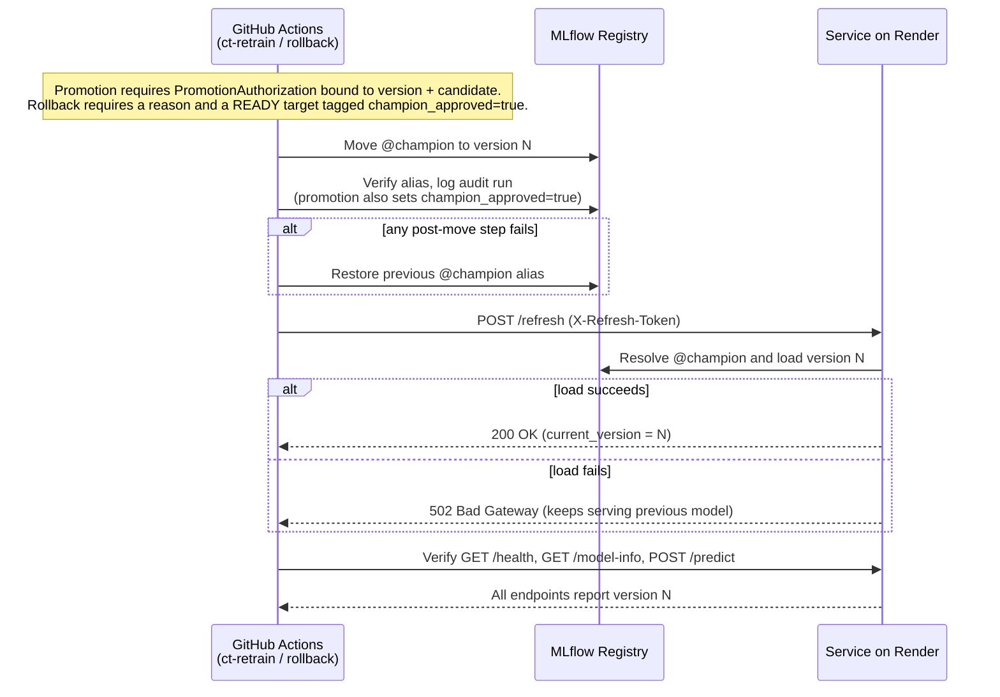

# Deployment & Operations

Production runs on **Render** as a Docker web service: <https://enercast-mlops-tree.onrender.com>.

The container image (`Dockerfile`, based on `python:3.12-slim`, running as non-root `appuser`) packages `app/`, `ml/`, and locked runtime dependencies only—no datasets, training/development dependencies, or model weights are baked into the image. On startup (or on `POST /refresh`), the service fetches `wattwise-energy-forecaster@champion` from the DagsHub MLflow Model Registry.

> Looking to build and smoke-test the container locally? Follow the local Docker instructions in [`CONTRIBUTING.md`](../CONTRIBUTING.md#2-local-checks--docker-verification).

---

## Runtime Configuration (Render)

All runtime settings are injected as environment variables; nothing is hard-coded in the image:

| Variable | Required | Purpose |
| :--- | :---: | :--- |
| `MLFLOW_TRACKING_URI` | Yes | DagsHub MLflow tracking server and model registry URL |
| `MLFLOW_TRACKING_USERNAME` | Yes | DagsHub username |
| `MLFLOW_TRACKING_PASSWORD` | Yes | DagsHub personal access token |
| `REFRESH_API_TOKEN` | Yes (for live reloads) | Shared secret for `POST /refresh`; must match the GitHub Actions secret. Leaving it unset disables `/refresh` (`401`). |
| `PORT` | Injected by Render | Listen port inside the container (defaults to `8000`) |

---

## GitHub Actions Workflows

| Workflow (Job) | Trigger | Branch Scope | Purpose |
| :--- | :--- | :--- | :--- |
| `ci-pr.yml` (`ci-pass` + 7 sub-jobs) | `pull_request` (`opened`, `synchronize`, `reopened`, `edited`) | PRs into `dev`, `staging`, `main` | Runs `uv lock --check`, `actionlint`, `gitleaks` secrets scan, Ruff lint/format, Pytest, Docker build + container smoke test (`scripts/smoke_test.sh`), and Conventional Commit PR title validation. `ci-pass` is the required status check. |
| `enforce-source-branch.yml` (`check-source`) | `pull_request` | PRs into `staging`, `main` | Enforces promotion order: only `dev` → `staging` and `staging` → `main` are allowed. |
| `cd-staging.yml` (`validate`) | `push`, `workflow_dispatch` | `staging` (manual runs on other branches test without publishing) | Resolves `@champion`, builds the Docker image, starts it against the real MLflow registry, runs `scripts/smoke_test.sh`, and (on `refs/heads/staging`) pushes `ghcr.io/chenaucarre/enercast-mlops:<commit-sha>` and `:tree-<tree-hash>`. |
| `cd-prod.yml` (`deploy`) | `push`, `workflow_dispatch` | `main` (`production` environment) | Looks up `:tree-<tree-hash>` in GHCR (fails if staging never verified that tree), triggers the Render deploy hook with the immutable image digest, polls the Render API up to 15 minutes until `live`, then runs `scripts/smoke_test.sh` (`SMOKE_TIMEOUT=300`) against `API_BASE_URL` with the expected `@champion` version. |
| `ct-retrain.yml` (`continuous-training`) | `workflow_dispatch` (`dataset-version`, `force-initial-training`) | `dev`, `staging`, or `main` (must exist on default branch `main` to dispatch; use `main` for production) | Pulls the selected DVC snapshot, validates registry state and data contract, runs `python -m ml.pipeline`, and—if `@champion` moved—calls `POST /refresh` and verifies `/health`, `/model-info`, and `/predict`. See [`ml/README_experiments.md`](../ml/README_experiments.md) for training and gating policy. |
| `rollback.yml` (`rollback`) | `workflow_dispatch` (`target-version`, `reason`) | `dev`, `staging`, or `main` (same dispatch rule as `ct-retrain.yml`) | Validates inputs and service credentials, restores `@champion` to a `READY` version tagged `champion_approved=true`, calls `POST /refresh`, and verifies `/health`, `/model-info`, and `/predict`. |

### Why Images Are Tagged by Git Tree Hash

Merging `staging` → `main` creates a new merge commit SHA, but the repository file tree is identical to the verified `staging` commit. Tagging images with `:tree-<tree-hash>` in `cd-staging.yml` allows `cd-prod.yml` to resolve and deploy the exact container digest tested in staging—without rebuilding and without risking unvalidated code reaching production.

### Concurrency Serialization

`ct-retrain.yml` and `rollback.yml` share the `ct-retrain-champion-registry` concurrency group (`cancel-in-progress: false`), guaranteeing that two workflows can never move the `@champion` alias simultaneously. `cd-staging.yml` and `cd-prod.yml` each serialize on their own concurrency groups (`cd-staging` and `cd-prod`).

### GitHub Repository Variables & Secrets

| Type | Name | Consumed By | Notes |
| :--- | :--- | :--- | :--- |
| Variable | `MLFLOW_TRACKING_URI` | `ci-pr`, `cd-staging`, `cd-prod`, `ct-retrain`, `rollback` | DagsHub MLflow server URL |
| Variable | `MLFLOW_TRACKING_USERNAME` | `ci-pr`, `cd-staging`, `cd-prod`, `ct-retrain`, `rollback` | Also used as DVC remote username in `ct-retrain` |
| Variable | `API_BASE_URL` | `cd-prod`, `ct-retrain`, `rollback` | Live service base URL (`https://enercast-mlops-tree.onrender.com`) |
| Secret | `MLFLOW_TRACKING_PASSWORD` | `ci-pr`, `cd-staging`, `cd-prod`, `ct-retrain`, `rollback` | DagsHub token; also authenticates DVC remote in `ct-retrain` |
| Secret | `REFRESH_API_TOKEN` | `ci-pr`, `cd-staging`, `ct-retrain`, `rollback` | Must match Render's `REFRESH_API_TOKEN` |
| Secret | `RENDER_DEPLOY_HOOK_URL` | `cd-prod` | Render webhook URL used to trigger digest-pinned deploys |
| Secret | `RENDER_API_KEY` | `cd-prod` | Render API token used to poll deployment status |

---

## Code Release & Rollback Procedures

### Standard Release

1. Open and merge a PR from `dev` → `staging` and wait for `cd-staging.yml` to push the verified image to GHCR.
2. Open and merge a PR from `staging` → `main`. `cd-prod.yml` deploys the staging-verified digest to Render and runs the live smoke test automatically.

### Re-Deploy Current `main`

Re-run production deployment for the current `main` tree via GitHub CLI:

```bash
gh workflow run cd-prod.yml --ref main
```

### Manual Deployment by Digest

To reproduce `cd-prod.yml` manually (ensure `main` is fetched locally and authenticate to `ghcr.io` with `docker login` if the package is private):

```bash
image=ghcr.io/chenaucarre/enercast-mlops
digest=$(docker buildx imagetools inspect "$image:tree-$(git rev-parse 'main^{tree}')" \
  --format '{{json .Manifest}}' | jq -er .digest)
curl -sf -X POST "$RENDER_DEPLOY_HOOK_URL&imgURL=$(jq -rn --arg v "$image@$digest" '$v|@uri')"
SMOKE_TIMEOUT=300 scripts/smoke_test.sh https://enercast-mlops-tree.onrender.com \
  "$(uv run python -c 'from ml.registry import get_champion_version; print(get_champion_version())')"
```

### Rolling Back Code

To roll back the application container without touching the active model, either trigger Render's **Rollback** action on a previous known-good deploy or manually redeploy an earlier verified `<commit-sha>` tag/digest from GHCR using the command above.

---

## Model Release, Live Refresh & Incident Recovery

Model changes never redeploy the Docker container. Both `ct-retrain.yml` (when a candidate passes the promotion policy) and `rollback.yml` update `@champion` in MLflow and instruct the running service to reload it:



`POST /refresh` passes no model artifact or version number; the service always resolves `@champion` directly from MLflow, keeping the registry as the single source of truth.

### Behavior When Service Credentials Are Unset

* **`ct-retrain.yml`**: Refreshes the service only when `@champion` actually changed. If `API_BASE_URL` or `REFRESH_API_TOKEN` is missing, the workflow skips live refresh and verification and emits a warning in the job summary (the alias update itself remains in MLflow).
* **`rollback.yml`**: Validates that both `API_BASE_URL` and `REFRESH_API_TOKEN` are set **before** touching the registry, and fails fast if either is missing.

### Failure Modes & Recovery Runbook

* **Failed `/refresh` (`502 Bad Gateway`)**: The running container keeps serving the previously loaded model so live traffic is not interrupted. `ct-retrain.yml` fails at the refresh step and logs a warning suggesting `rollback.yml` with the previous champion version.
* **Container restart while `@champion` points to a broken version**: The process starts with no loaded model; `/health`, `/model-info`, and `/predict` return `503 Service Unavailable`, and `cd-prod.yml`'s smoke test fails.
* **Recovery procedure**:
  1. Dispatch `rollback.yml` (on `main`) with `target-version` set to the last known-good approved version and an incident `reason`. The workflow restores `@champion`, calls `POST /refresh`, and verifies `/health`, `/model-info`, and `/predict`.
  2. If the service still fails to load or serve a known-good model version, the issue is in the container image or runtime configuration rather than the model—roll back the Render deployment to the previous verified image.
