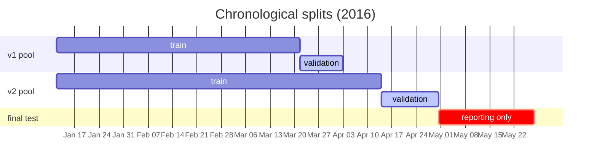

# Data Documentation

This document specifies the dataset provenance, feature schema, data quality contract, chronological split design, and DVC reproducibility metadata for `enercast-mlops`.

---

## 1. Source & License

* **Dataset:** Appliances Energy Prediction
* **Source:** UCI Machine Learning Repository (ID: `374`)
* **DOI:** <https://doi.org/10.24432/C5VC8G>
* **Author & Year:** Luis Candanedo (2017)
* **License:** Creative Commons Attribution 4.0 International (CC BY 4.0)
* **Original file:** `energydata_complete.csv`
* **Usage terms:** Attribution to the original author and the UCI Machine Learning Repository is required. All derived chronological snapshots inherit the CC BY 4.0 license.

Raw and derived CSV files are tracked with DVC on DagsHub and are never committed to Git.

---

## 2. Dataset Overview & Feature Schema

The raw dataset records **19,735 observations** from a single household over roughly 4.5 months (`2016-01-11 17:00:00` to `2016-05-27 18:00:00`) at fixed 10-minute intervals.

### Raw Columns (29 Total)

* **`date`**: observation timestamp (`YYYY-MM-DD HH:MM:SS`); used for chronological ordering and feature derivation, not passed directly to the model.
* **`Appliances`** *(target)*: total household appliance energy consumption in Watt-hours (`Wh`). Distribution across the full dataset is strongly right-skewed: **median `60 Wh`**, **mean `97.7 Wh`**, **standard deviation `102.5 Wh`**, range **`10–1,080 Wh`**.
* **`lights`**: lighting energy consumption (`Wh`).
* **`T1`–`T9` and `RH_1`–`RH_9`**: temperature (`°C`) and relative humidity (`%`) across nine building sensor zones (indoor rooms plus the north-side exterior sensor `T6`/`RH_6`).
* **`T_out`, `Press_mm_hg`, `RH_out`, `Windspeed`, `Visibility`, `Tdewpoint`**: outdoor readings from the nearby Chièvres weather station.
* **`rv1`, `rv2`**: synthetic random noise columns, excluded from model features.

### Model Inputs (27 Features)

`ml/preprocess.py` transforms the 25 explanatory raw columns into 27 `float64` model inputs in a fixed column order (`FEATURE_COLUMNS`):

1. Normalizes UCI weather column names `T_out` → `To` and `Press_mm_hg` → `Pressure` (accepts either naming convention, but rejects inputs containing both simultaneously).
2. Derives `hour` (`0–23`) and `day_of_week` (`0–6`) from `date`.
3. Drops `date`, `rv1`, and `rv2`.

---

## 3. Data Quality & Pipeline Contract

Verified properties of the raw snapshot (`energydata_complete.csv`):

* 19,735 rows and 29 columns with no missing values
* No duplicate rows or duplicate timestamps
* Strictly ascending timestamps at regular 10-minute intervals

Before any training or evaluation run, `ml/pipeline.py`, `ml/splits.py`, and `ml/preprocess.py` re-verify the data contract and abort immediately on any violation:

* **File integrity:** the local CSV's MD5 checksum must match its committed `.dvc` pointer.
* **Timestamps:** `date` must be present, strictly parseable as `%Y-%m-%d %H:%M:%S`, unique, and sorted in ascending order.
* **Target (`Appliances`):** must be present, numeric, finite, and non-negative (`>= 0`).
* **Features:** all 27 features in `FEATURE_COLUMNS` must be present, numeric, and finite (no `NaN` or `±inf`).
* **Split validity:** train and validation splits must each contain at least one row with `max(train.date) < min(validation.date)`.

> **Training vs. inference validation:** `ml/preprocess.py` validates feature presence, types, and finiteness. Physical sensor range bounds (such as `0 <= RH <= 100` or `-20 <= T <= 60`) are additionally enforced on live inference requests by Pydantic in `app/schemas.py` (see [`docs/API.md`](../docs/API.md#request-schema--validation-rules)).

---

## 4. Chronological Split Design & Versions

All snapshots are partitioned chronologically by `ml/prepare_data.py` without shuffling so models never train on future observations.

### Dataset Snapshots

| Snapshot | Coverage | Rows | Role & Changes |
| :--- | :--- | ---: | :--- |
| `raw` | Full period (100%) | 19,735 | Immutable UCI source snapshot. |
| `v1` | First 60% | 11,841 | Initial baseline training pool (`data/versions/v1/train.csv`). |
| `v2` | First 80% | 15,788 | Continuous-training pool (`data/versions/v2/train.csv`). Extends `v1` with the next 20% of later observations; the first 11,841 rows are byte-for-byte identical to `v1` with no relabeling or schema changes. |
| `final test` | Last 20% | 3,947 | Shared held-out reporting set (`data/versions/test/final_test.csv`), unchanged across `v1` and `v2`. |

### Train / Validation Breakdown

Within each training pool (`v1` or `v2`), `ml/splits.py` reserves the final 15% of rows (rounded down, `VALIDATION_FRACTION = 0.15`) for validation:

| Pool | Train Rows | Validation Rows | Train Period | Validation Period |
| :--- | ---: | ---: | :--- | :--- |
| `v1` | 10,065 | 1,776 | `2016-01-11 17:00` – `2016-03-21 14:20` | `2016-03-21 14:30` – `2016-04-02 22:20` |
| `v2` | 13,420 | 2,368 | `2016-01-11 17:00` – `2016-04-13 21:30` | `2016-04-13 21:40` – `2016-04-30 08:10` |
| `final test` | — | 3,947 *(reporting only)* | — | `2016-04-30 08:20` – `2016-05-27 18:00` |



### Leakage Prevention & Final Test Isolation

* **Fair continuous-training comparison:** The `v2` validation window (`2016-04-13 21:40` – `2016-04-30 08:10`) begins strictly after the entire `v1` pool ends (`2016-04-02 22:20`), ensuring the `v1` champion has never seen the observations used to compare it against the `v2` candidate.
* **Strict final-test isolation:** `ml.pipeline.load_data(version)` reads only `data/versions/<version>/train.csv`, and `ct-retrain.yml` pulls only the selected training pointer. `final_test.csv` is read exclusively by `ml.pipeline.load_final_test_data()` via `python -m ml.pipeline --final-evaluation` for post-selection reporting, so it never influences model selection, tuning, or promotion. Because `final_test.csv` is fixed across versions, post-selection reporting compares `v1` and `v2` models on the exact same held-out period.

---

## 5. DVC Snapshots & Reproducibility

All `.dvc` pointers entered `dev` in squash commit `55a871a955d091cbb031e07c272fc812ea4f62ad` (`55a871a`, PR #6). The configured DVC remote (`.dvc/config`) is:

```text
https://dagshub.com/MezziNour/enercast-mlops.dvc
```

| Snapshot | DVC Pointer | MD5 Checksum | Git Commit |
| :--- | :--- | :--- | :--- |
| `raw` | `data/raw/energydata_complete.csv.dvc` | `69ef922b5fcafcd49097cfc09e07167e` | `55a871a955d091cbb031e07c272fc812ea4f62ad` |
| `v1` | `data/versions/v1/train.csv.dvc` | `b2fc482fe85cd1779a0faa5f7d6de625` | `55a871a955d091cbb031e07c272fc812ea4f62ad` |
| `v2` | `data/versions/v2/train.csv.dvc` | `d08e0d2745ace0677a6330d8cc20795a` | `55a871a955d091cbb031e07c272fc812ea4f62ad` |
| `final test` | `data/versions/test/final_test.csv.dvc` | `082db6d3abab0442e8721d732e1db116` | `55a871a955d091cbb031e07c272fc812ea4f62ad` |

After configuring local DVC credentials (see [`CONTRIBUTING.md`](../CONTRIBUTING.md#pull-datasets-with-dvc)), pull individual snapshots or all tracked datasets:

```bash
uv run dvc pull data/versions/v1/train.csv.dvc
uv run dvc pull data/versions/v2/train.csv.dvc
uv run dvc pull data/versions/test/final_test.csv.dvc
```

---

## 6. Known Limitations

* **Single household & short horizon:** The dataset covers one house over ~4.5 months (winter to late spring), limiting generalization to other buildings or full-year seasonal patterns.
* **Noisy, heavy-tailed target:** Short bursts of appliance usage create high variance (`median 60 Wh` vs. `mean 97.7 Wh`, `max 1,080 Wh`). See [`ml/README_experiments.md`](README_experiments.md) for metric selection and modeling implications.
* **Simulated data delivery:** `v2` extends `v1` chronologically with additional observations; it does not introduce new sensors, schema updates, or corrected labels.
