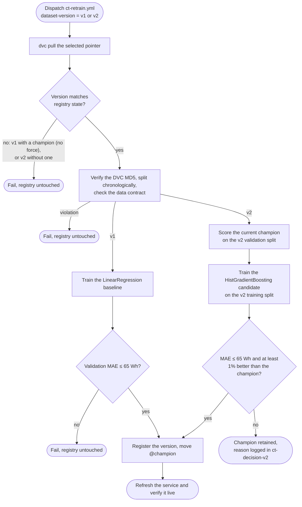

# Experiment Tracking and Model Selection

This document describes the primary metric, evaluation protocol, retraining rule, quality gates, MLflow tracking and registry conventions, and the evidence behind the production champion.

## 1. MLflow setup

- **Tracking server and model registry:** shared, persistent MLflow server hosted on DagsHub.
- **Configuration:** `MLFLOW_TRACKING_URI`, `MLFLOW_TRACKING_USERNAME` and `MLFLOW_TRACKING_PASSWORD` from the environment. See [`docs/DEPLOYMENT.md`](../docs/DEPLOYMENT.md).
- **Experiment:** `WattWise-energy-forecasting-final`.
- **Registered model:** `wattwise-energy-forecaster`.
- **Champion alias:** `champion`.
- **Approval tags:** `champion_approved=true` and `champion_approval_reason` on the promoted model version.
- **Local tracking:** `file:./mlruns` is for exploration only. The continuous-training workflow and deployed application use the shared registry. Registry writes (`register_model`, `promote_model`, `rollback_champion`) are refused outside GitHub Actions.

How the inference service loads and reports the champion is described in [`docs/API.md`](../docs/API.md).

## 2. Primary metric

**MAE (Mean Absolute Error) in Wh. Lower is better.**

MAE is the primary metric because:

- The application predicts appliance energy consumption in Wh. MAE is directly interpretable in the same unit: a MAE of 41 Wh means the prediction is off by 41 Wh on average.
- The target is noisy and heavy-tailed (median 60 Wh, mean about 96 Wh). MAE is less sensitive to a few large spikes than RMSE, so it better reflects the typical user-facing error.
- RMSE and R² are logged as secondary diagnostics. R² is low because the available features explain only part of the consumption variance; it is not the promotion gate.

## 3. Evaluation protocol

- All splits are chronological; the data is never shuffled.
- The validation split is the last 15% of the selected training pool, rounded down (`VALIDATION_FRACTION = 0.15` in `ml/splits.py`).
- The final test is the last 20% of the full dataset. It is never used for training, hyperparameter tuning, model selection, or promotion.
- The champion and candidate are scored on the **same validation observations** of the selected dataset version.
- The final test is used only by `python -m ml.pipeline --final-evaluation` for reporting after model selection.
- `load_data`, `run_v1`, and `run_v2` never read the final test.

See [`README_data.md`](README_data.md) for the exact periods, row counts, and DVC hashes.

## 4. Retraining rule

The trigger is the delivery of a new dataset version, not a drift monitor:

- `v1` is the initial release. It is dispatched once; the workflow refuses it as soon as a champion exists.
- `v2` is the first new delivery. It extends `v1` chronologically and is dispatched manually through `workflow_dispatch`. Its arrival is the trigger to retrain, and the workflow refuses `v2` while no champion exists.
- Every CT run scores the current champion on the new validation split before any candidate is trained. The candidate is then compared with the champion on the same held-out observations.
- Retraining therefore always happens for a new version, but promotion is not automatic: the candidate must satisfy the quality floor and the minimum improvement. Otherwise, the champion is retained and the decision run logs the reason.
- No schedule or drift detector is configured. A future delivery would add a `v3` pointer and reuse the same workflow unchanged.

### Continuous-training workflow

One `ct-retrain.yml` run, from dispatch to decision:



The gates are detailed in section 5. How the alias move reaches the live service is shown in [`docs/DEPLOYMENT.md`](../docs/DEPLOYMENT.md#how-a-model-change-reaches-the-service).

## 5. Quality gates and promotion policy

The policy is implemented in `ml/policy.py`:

- `MAX_MAE = 65.0` Wh: the quality floor.
- `MIN_IMPROVEMENT = 0.01`: the candidate must improve the champion's MAE by at least 1% on the same validation split.
- The candidate MAE must be finite and non-negative.
- The candidate must satisfy `0 <= MAE <= 65.0`.
- The relative improvement is `(champion_mae - candidate_mae) / champion_mae`; it must be at least `0.01`.
- If no candidate passes, the current champion is retained and the decision run records the rejection reason.
- Initial release (`run_v1`): the baseline must satisfy `MAE <= 65`; it is promoted as the first champion.
- A promotion requires a typed `PromotionAuthorization` bound to the registered version and the candidate name (`promote_model`). A direct alias edit is refused by the registry code.
- A rollback (`rollback_champion`) requires an explicit reason and a target version that is `READY` and carries `champion_approved=true`. It is the only other supported path that can move the alias.

## 6. Models

| Role | Run name | Estimator | Dataset |
| --- | --- | --- | --- |
| Baseline | `baseline-linear-regression-v1` | `LinearRegression` | `v1` |
| Candidate | `candidate-hist-gradient-boosting-v2` | `HistGradientBoostingRegressor` | `v2` |

Candidate hyperparameters from `ml/train.py`:

```text
loss=absolute_error
max_iter=300
max_leaf_nodes=7
learning_rate=0.05
min_samples_leaf=30
l2_regularization=1.0
random_state=42
```

### Model rationale

- `LinearRegression` is a simple, interpretable baseline. It establishes a floor, validates the end-to-end pipeline, and is cheap to serve.
- `HistGradientBoostingRegressor` captures non-linear interactions between time, weather, and indoor conditions. The `absolute_error` loss directly targets a MAE-like objective. The model remains fast enough for CPU training and low-latency inference.
- The candidate configuration is fixed in code. It was not tuned on the final test; the fixed configuration also avoids overfitting the small validation split.

## 7. Experimental evidence

The metrics below were reproduced from the committed DVC snapshots with the committed code on 2026-11-24. They must match the corresponding shared MLflow runs (section 8) created by the first `v1` and `v2` workflow runs; those runs are the source of truth for the submitted evidence.

### 7.1 Initial release: v1 baseline on v1 validation

| Model | Split | MAE (Wh) | RMSE (Wh) | R² |
| --- | --- | ---: | ---: | ---: |
| `LinearRegression` | v1 validation (1,776 rows) | 49.892 | 88.710 | 0.0025 |

The baseline satisfies the 65 Wh quality floor and becomes the initial champion. This is the evidence for the initial release.

### 7.2 Continuous training: champion vs candidate on v2 validation

| Model | Split | MAE (Wh) | RMSE (Wh) | R² |
| --- | --- | ---: | ---: | ---: |
| Champion: v1 `LinearRegression` | v2 validation (2,368 rows) | 63.294 | 96.438 | -0.0030 |
| Candidate: v2 `HistGradientBoosting` | v2 validation (2,368 rows) | 41.192 | 90.021 | 0.1260 |

- Candidate MAE improvement: **34.92%**, above the 1% minimum.
- Candidate MAE 41.192 Wh is below the 65 Wh quality floor.
- Decision: **promote**; the champion alias moves to the new version.
- The candidate improves both MAE and RMSE, and its R² is positive while the champion's is slightly negative.

### 7.3 Final test (reporting only, never used for selection)

| Model | Split | MAE (Wh) | RMSE (Wh) | R² |
| --- | --- | ---: | ---: | ---: |
| v1 `LinearRegression` | final test (3,947 rows) | 72.583 | 98.808 | -0.1780 |
| v2 `HistGradientBoosting` | final test (3,947 rows) | 55.576 | 89.997 | 0.0227 |

- The final test confirms the ranking: the candidate reduces MAE by **23.43%** (72.583 Wh to 55.576 Wh).
- The candidate is below the 65 Wh floor on the final test; the baseline is above it.
- These numbers are reported after selection. They did not influence the promotion decision.

### 7.4 Interpretation

- The target is noisy: median 60 Wh, mean about 96 Wh. The candidate's 41.2 Wh MAE on v2 validation is about 43% of the mean; the champion's 63.3 Wh is about 66%.
- R² is low because the available features explain only part of the appliance consumption variance. MAE is the primary metric for the application.
- The candidate's improvement is consistent on validation and on the final test, which supports the production choice.

## 8. MLflow tracking: what each run logs

### Training runs (`run_experiment`)

- **Params:** model hyperparameters, `dataset_version`, `train_dvc_hash`, `git_commit`, `git_dirty`, `model_type`, train/validation row counts, `validation_fraction`, train and validation periods, feature count.
- **Metrics:** `validation_mae`, `validation_rmse`, `validation_r2`.
- **Tags:** `git_commit`, `git_dirty`, `model_role`, `selection_split=validation`, `final_test_usage=separate_final_evaluation`, `final_test_used_for_selection=false`, `promotion_eligible=true`.
- **Artifacts:** fitted model, `metrics.json`, `validation_predictions.csv`, `training_distribution.json` (per-feature decile edges and proportions of the training split, the API's drift reference).

### CT decision run (`ct-decision-v2`)

- **Params:** `dataset_version`, `previous_champion_version`, `candidate_count`, `selection_split=validation`.
- **Metrics:** `champion_validation_mae`, `<candidate>_validation_mae`.
- **Tags:** `promotion_decision`, `selected_candidate`, `selection_split`, `final_test_used_for_selection=false`, `decision_reason`.

### Alias audit runs (`champion-alias-promote` / `champion-alias-rollback`)

- **Params:** `model_name`, `operation`, `previous_champion_version`, `new_champion_version`, `decision_reason`.
- **Tags:** `champion_operation`, `champion_previous_version`, `champion_new_version`, `champion_authorized_by`, `champion_audit_result=success`.

### Final evaluation run (`final-evaluation-v2`)

- **Params:** `dataset_version`, `evaluated_model_version`, `test_dvc_hash`, `test_rows`, test period start/end.
- **Metrics:** `final_test_mae`, `final_test_rmse`, `final_test_r2`.
- **Tags:** `evaluation_split=final_test`, `final_test_usage=reporting_only`, `final_test_used_for_selection=false`, `promotion_eligible=false`.
- **Artifacts:** `metrics.json`, `final_test_predictions.csv`.

## 9. Reproducing experiments and running workflows

Pull the dataset first with DVC (see `README_data.md`, section 6). Never commit `mlruns/`, `.dvc/config.local`, or any credential file.

Local runs are for exploration only: `register_model`, `promote_model` and `rollback_champion` refuse to run unless `GITHUB_ACTIONS=true`, so a laptop cannot move the shared `champion` alias.

Local tracking example:

```bash
uv sync --frozen --group experiment

# Local tracking only: trains and logs runs, never registers or promotes.
export MLFLOW_TRACKING_URI="file:./mlruns"
uv run python -m ml.train
```

In GitHub Actions, where the shared registry is reachable and the write guard passes:

- `ct-retrain.yml` runs the initial release (`v1`) or continuous training (`v2`), promotes only when the gates pass, refreshes the service, and verifies the loaded version with a live prediction. Its `force-initial-training` input allows a deliberate `v1` rebuild when a champion already exists; leave it off for routine training.
- `rollback.yml` restores a previously approved version, refreshes the service, and verifies it with a live prediction.
- Both workflows share the `ct-retrain-champion-registry` concurrency group, so they never move the alias concurrently. Their variables and secrets are listed in [`docs/DEPLOYMENT.md`](../docs/DEPLOYMENT.md#github-settings-used-by-the-workflows).
- If `API_BASE_URL` or `REFRESH_API_TOKEN` is missing, `ct-retrain.yml` skips the live refresh and verification with a warning (the job summary says so), and `rollback.yml` fails before moving the alias.
- Both workflows can only be dispatched once they are on the default branch (`main`), so they run from released code.

## 10. Decision log and rollback

- Promotion is only possible through `promote_model` with a typed `PromotionAuthorization`. The registry refuses a direct alias move.
- The promotion audit run records the previous and new champion versions and the policy reason.
- When a candidate fails, the champion is retained and the `ct-decision-v2` run records the rejection reason.
- Rollback uses `rollback_champion` with an explicit reason. The target must be `READY` and carry `champion_approved=true`. The rollback audit run records the operation.
- If the service does not become ready after a promotion, follow [`docs/DEPLOYMENT.md`](../docs/DEPLOYMENT.md#when-the-app-does-not-become-ready-after-a-model-change).

## 11. Known limitations

- The final test is small (3,947 rows) and covers a single household; the reported metrics have sampling uncertainty.
- R² is low. The model is useful for MAE-oriented decisions but does not explain most of the variance.
- The candidate configuration is fixed and was not tuned on the final test. Further gains would require additional features (occupancy, weather forecasts, time-of-day interactions) and a larger evaluation set.
- The shared registry is the source of truth; local `mlruns/` runs are for exploration only.


