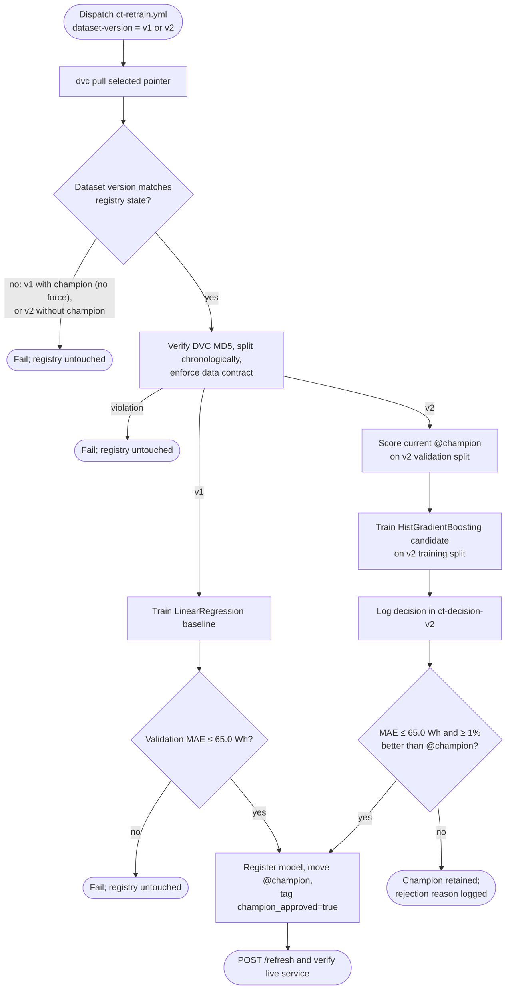

# Experiment Tracking & Model Governance

This document describes the MLflow conventions, evaluation metric, model configurations, continuous training and promotion policy, benchmark evidence, and MLflow logging schema for `enercast-mlops`.

---

## 1. MLflow Conventions & Write Guard

* **Tracking server & model registry:** Shared persistent MLflow server hosted on DagsHub (configured via `MLFLOW_TRACKING_URI`, `MLFLOW_TRACKING_USERNAME`, and `MLFLOW_TRACKING_PASSWORD`).
* **Experiment name:** `WattWise-energy-forecasting-final`
* **Registered model:** `wattwise-energy-forecaster` *(the `WattWise` prefix is the project's original MLflow identifier, kept unchanged for registry continuity)*
* **Production alias:** `champion` (`models:/wattwise-energy-forecaster@champion`)
* **Approval tags:** `champion_approved=true` and `champion_approval_reason` (written automatically onto every promoted version)
* **Registry write guard:** `register_model`, `promote_model`, and `rollback_champion` in `ml/registry.py` raise `LocalRegistryWriteForbidden` unless `GITHUB_ACTIONS=true`. Local runs can explore with `MLFLOW_TRACKING_URI=file:./mlruns`, but only GitHub Actions workflows can modify the shared registry.

---

## 2. Primary Metric & Evaluation Protocol

### Primary Metric: MAE (Wh) — Lower Is Better

* **Direct interpretability:** MAE is measured in Watt-hours (`Wh`), matching the target unit. An MAE of `41.2 Wh` means predictions differ from actual 10-minute consumption by `41.2 Wh` on average.
* **Robustness to spikes:** The `Appliances` target is noisy and right-skewed (full-dataset median `60 Wh`, mean `97.7 Wh`, std `102.5 Wh`). Compared to RMSE, MAE avoids letting rare high-load spikes dominate model selection.
* **Secondary diagnostics:** RMSE and R² are logged alongside MAE for diagnostic visibility. R² remains modest because indoor/weather readings explain only part of appliance usage variance (occupancy and device schedules are unobserved); R² is never used as a promotion gate.

### Evaluation Rules

* All splits are strictly chronological (never shuffled), reserving the final 15% of each training pool (`v1` or `v2`) for validation (`VALIDATION_FRACTION = 0.15`).
* During continuous training, the current `@champion` and each candidate are evaluated on the **exact same validation split**.
* `final_test.csv` (last 20% of the full dataset) is never accessed by `load_data`, `run_v1`, or `run_v2`. It is read solely by `python -m ml.pipeline --final-evaluation` for post-selection reporting.

See [`ml/README_data.md`](README_data.md#4-chronological-split-design--versions) for exact date boundaries, row counts, and DVC hashes.

---

## 3. Models & Hyperparameters

| Role | Run Name | Estimator | Dataset |
| :--- | :--- | :--- | :--- |
| Baseline | `baseline-linear-regression-v1` | `LinearRegression` | `v1` |
| Candidate | `candidate-hist-gradient-boosting-v2` | `HistGradientBoostingRegressor` | `v2` |

Fixed candidate hyperparameters defined in `ml/train.py`:

```text
loss=absolute_error
max_iter=300
max_leaf_nodes=7
learning_rate=0.05
min_samples_leaf=30
l2_regularization=1.0
random_state=42
```

### Design Rationale

* **`LinearRegression`** establishes a fast, interpretable baseline that validates the end-to-end training, registry, and serving pipeline.
* **`HistGradientBoostingRegressor`** captures non-linear interactions across time, indoor zones, and weather while directly optimizing L1 error (`loss="absolute_error"`), aligning training with the MAE gate while staying fast for CPU training and inference.
* Hyperparameters are fixed in source code rather than tuned iteratively on the small validation split (and never tuned on the final test), reducing overfitting risk.

---

## 4. Continuous Training Flow & Promotion / Rollback Policy

### Retraining Trigger

Retraining is triggered manually via `ct-retrain.yml` (`workflow_dispatch`) when a new dataset snapshot is delivered (no scheduled cron job or automated drift detector is configured):

* **`v1` (initial release):** Establishes the baseline champion when no champion exists. If a champion already exists, `v1` fails unless `force-initial-training` (`--force-initial-training`) is explicitly enabled for a deliberate registry rebuild.
* **`v2` (continuous training):** Requires an existing champion. Scores the active `@champion` on the `v2` validation split, trains the `v2` candidate on the `v2` training split, compares both on the `v2` validation split, logs a `ct-decision-v2` run recording the outcome, and promotes only if all policy gates pass. Adding a future `v3` snapshot follows the same pattern.



### Policy Gates & Authorization (`ml/policy.py`, `ml/registry.py`)

* **Quality floor (`MAX_MAE = 65.0` Wh):** Candidate validation MAE must be finite and satisfy `0 <= MAE <= 65.0`.
* **Minimum relative improvement (`MIN_IMPROVEMENT = 0.01`, i.e., 1%):** For continuous training (`v2`), relative improvement `(champion_mae - candidate_mae) / champion_mae` (rounded to 9 decimal places to avoid floating-point boundary artifacts) must be `>= 0.01`. If no candidate passes, the existing champion is retained and `ct-decision-v2` logs the rejection reason.
* **Typed promotion authorization:** `promote_model()` refuses direct calls unless given a `PromotionAuthorization` produced by `PromotionAuthorization.from_decision()` bound to both the registered version and candidate name.
* **Audited rollback:** `rollback_champion()` is the only other supported path that moves `@champion`. It requires a non-empty `reason` and a target version whose status is `READY` and whose MLflow tags include `champion_approved=true`.
* **Automatic alias restoration:** If alias verification, audit logging, or approval tagging fails after `@champion` moves, `ml/registry.py` restores the previous alias (or deletes the newly created alias if no champion existed before).

---

## 5. Benchmark Evidence

The metrics below were reproduced from the committed DVC snapshots and source code on `2026-11-24`. The corresponding runs in the shared DagsHub MLflow server created by the `v1` and `v2` workflow dispatches serve as the authoritative audit record.

### 5.1 Initial Release (`v1` Validation — 1,776 Rows)

| Model | Split | MAE (Wh) | RMSE (Wh) | R² |
| :--- | :--- | ---: | ---: | ---: |
| `LinearRegression` | `v1` validation | `49.892` | `88.710` | `0.0025` |

The baseline satisfies `MAE <= 65.0 Wh` and is promoted as the initial `@champion`.

### 5.2 Continuous Training (`v2` Validation — 2,368 Rows)

| Model | Split | MAE (Wh) | RMSE (Wh) | R² |
| :--- | :--- | ---: | ---: | ---: |
| Champion: `v1` `LinearRegression` | `v2` validation | `63.294` | `96.438` | `-0.0030` |
| Candidate: `v2` `HistGradientBoosting` | `v2` validation | `41.192` | `90.021` | `0.1260` |

* **Relative MAE improvement:** **34.92%** (well above the 1% minimum).
* **Quality floor:** `41.192 Wh <= 65.0 Wh`.
* **Decision:** **Promote** — `@champion` moves to the `v2` candidate. RMSE and R² also improve over the baseline.

### 5.3 Independent Final Test (Reporting Only — 3,947 Rows)

| Model | Split | MAE (Wh) | RMSE (Wh) | R² |
| :--- | :--- | ---: | ---: | ---: |
| `v1` `LinearRegression` | `final_test` | `72.583` | `98.808` | `-0.1780` |
| `v2` `HistGradientBoosting` | `final_test` | `55.576` | `89.997` | `0.0227` |

* Confirms the validation ranking with a **23.43%** MAE reduction (`72.583 Wh` → `55.576 Wh`).
* The `v2` candidate remains below the `65.0 Wh` threshold on the held-out period, whereas the `v1` baseline exceeds it.
* Measured strictly after model selection; these figures did not influence promotion.

### 5.4 Interpretation

Relative to the full-dataset mean (`97.7 Wh`, median `60 Wh`), the `v2` candidate's validation MAE (`41.2 Wh`) is ~42% of the mean compared with ~65% for the `v1` champion (`63.3 Wh`). Consistent improvements across both the `v2` validation window and the independent final test support promoting the gradient-boosted model to production.

---

## 6. MLflow Logging Contract

### Training Runs (`run_experiment`)

* **Params:** estimator hyperparameters, `dataset_version`, `train_dvc_hash`, `git_commit`, `git_dirty`, `model_type`, `train_rows`, `validation_rows`, `feature_count`, `validation_fraction`, `train_period_start`, `train_period_end`, `validation_period_start`, `validation_period_end`
* **Metrics:** `validation_mae`, `validation_rmse`, `validation_r2`
* **Tags:** `git_commit`, `git_dirty`, `model_role`, `selection_split=validation`, `final_test_usage=separate_final_evaluation`, `final_test_used_for_selection=false`, `promotion_eligible=true`
* **Artifacts:** fitted scikit-learn model (`model`), `metrics.json`, `validation_predictions.csv`

### CT Decision Runs (`ct-decision-<dataset_version>`, e.g. `ct-decision-v2`)

* **Params:** `dataset_version`, `previous_champion_version`, `candidate_count`, `selection_split=validation`
* **Metrics:** `champion_validation_mae`, `<candidate>_validation_mae`
* **Tags:** `promotion_decision`, `selected_candidate`, `selection_split=validation`, `final_test_used_for_selection=false`, `decision_reason`

### Alias Audit Runs (`champion-alias-promote` / `champion-alias-rollback`)

* **Params:** `model_name`, `operation`, `previous_champion_version`, `new_champion_version`, `decision_reason`
* **Tags:** `champion_operation`, `champion_previous_version`, `champion_new_version`, `champion_authorized_by`, `champion_audit_result=success`

### Final Evaluation Runs (`final-evaluation-<dataset_version>`)

* **Params:** `dataset_version`, `evaluated_model_version`, `test_dvc_hash`, `test_rows`, `test_period_start`, `test_period_end`
* **Metrics:** `final_test_mae`, `final_test_rmse`, `final_test_r2`
* **Tags:** `evaluation_split=final_test`, `final_test_usage=reporting_only`, `final_test_used_for_selection=false`, `promotion_eligible=false`
* **Artifacts:** `metrics.json`, `final_test_predictions.csv`

---

## 7. Reproducing Experiments

### Local Exploration

After syncing dependencies and pulling DVC snapshots (see [`CONTRIBUTING.md`](../CONTRIBUTING.md#1-local-development-setup)), run local model comparison against a local MLflow store:

```bash
export MLFLOW_TRACKING_URI="file:./mlruns"
uv run python -m ml.train
```

`ml/train.py` trains both configured estimators on `v1`, logs runs locally to `mlruns/` (git-ignored), and prints validation metrics without registering or promoting models.

### Production Training & Rollback

Production training (`ct-retrain.yml`), model rollback (`rollback.yml`), live service refresh, concurrency controls, and incident recovery are documented in [`docs/DEPLOYMENT.md`](../docs/DEPLOYMENT.md#model-release-live-refresh--incident-recovery).

---

## 8. Known Limitations

* **Evaluation sample size:** The final test set contains 3,947 observations from a single household, introducing sampling uncertainty in reported metrics.
* **Low explained variance (R²):** Without occupancy, appliance state, or weather forecast features, the model is suited for MAE-oriented forecasting rather than explaining total consumption variance.
* **Fixed candidate configuration:** Hyperparameters are intentionally fixed to avoid overfitting the validation split; meaningful further accuracy gains would require richer features and a larger multi-building evaluation dataset.
